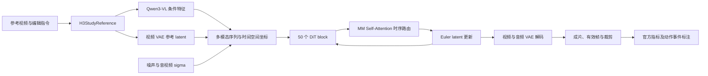

# 实际 H3 模型、精度与完整推理链路

更新：2026-10-24。本文记录已完成实验使用的实现、精度条件和源码入口，供接手 Agent 阅读与决策。

## 实验结果与比较范围

当前配对实验使用同一套 Comfy H3 权重、文本编码器、VAE、采样与推理后端，比较普通编辑和不同 Attention 引导。这样的设计可以测量**在当前量化 H3 系统中，引导方法带来的变化**。使用量化模型本身不会使这些配对实验失效。

官方发布的 H3-Base Ref2VA / FL2VA 是 BF16、CFG-distilled 权重。本文实验使用 Comfy 重新封装的 Ref2VA 推理权重；其时间条件表示、线性算子数值精度及文本编码器压缩方式均有明确记录。量化误差会进入 Q/K/V、Attention 概率和条件特征，可能改变绝对指标以及方法收益。当前资料中尚无同设置的官方 BF16 配对结果；量化与 BF16 的收益差异是待测量项。[官方模型卡](https://huggingface.co/MiniMaxAI/MiniMax-H3)、[Comfy 模型卡](https://huggingface.co/Comfy-Org/MiniMax-H3)。

论文中的实现名称可准确写为：**MiniMax H3-Base Ref2VA，Comfy pruned INT8 ConvRot DiT + NVFP4/AWQ Qwen3-VL 编码器**。如报告官方 BF16 上的方法效果，应对应提供该精度条件下的实验记录。精度、后端及数据集分别作为实验条件保留。

最新公开结果是 [R150 区间对照](../cloud/R150_十组引导区间对照_单文件.html)中的 **10 个 IVEBench 样例、1 个 FlexiAct 样例和 4 个历史样例**。其中新增的 short_0177「老虎替换为狮子」完成普通编辑、early、fixed、late、split、global_weak 六配置；原始视频、63 项数值指标、7 项 QA 状态、逐事件标注及运行验收见 [short_0177 完整证据](../../snapshots/execution-20261022/supervision/interval_short0177_20261024/README.md)。旧 `main10_20261022` 对应此前的 9 IVE + 1 FlexiAct 集合。

## 四个实际权重组件

完整文件名、大小、历史全文件 SHA 来源和本次只读文件头见 [实际运行记录](../../snapshots/runtime_h3_20261024/evidence/ACTUAL_RUNTIME.json)、[文件头汇总](../../snapshots/runtime_h3_20261024/HEADER_SUMMARY.json)与[源码采集清单](../../snapshots/runtime_h3_20261024/SOURCE_INVENTORY.json)。本次采集读取文件头与小型量化配置张量，未重新加载权重到 GPU。

| 组件 | 实际文件 | 已记录 SHA-256 |
|---|---|---|
| DiT | `minimax_h3_ref2va_pruned_int8_convrot.safetensors` | `9255f52b6677845ad238f20dfaafa94727053694127ab7f255c048f0f9365779` |
| 多模态编码器 | `qwen3vl_32b_minimax_h3_nvfp4_awq.safetensors` | `35a88d51044231fe332301d7a62aa81e3f2cba62febeb446e2c1e3e0ef76f2c6` |
| 视频 VAE | `minimax_h3_video_vae_fp16.safetensors` | `7c1f131492e7eddacaac9069a61b81bdd39de5cc96561e677c5eab1cdce5e522` |
| 音频 VAE | `minimax_h3_audio_vae_fp32.safetensors` | `8e505d95dd1561d47abd43d4238fd40d9bb1ae9e147ed0a4cba778d76ae4db48` |

DiT SHA 与 [Comfy 发布文件](https://huggingface.co/Comfy-Org/MiniMax-H3/blob/main/diffusion_models/minimax_h3_ref2va_pruned_int8_convrot.safetensors)一致。四个组件的文件存储精度与运行时计算精度分别记录：例如 INT8 DiT 接收 BF16 激活，在量化线性内执行激活量化；Attention 的 Q/K/V 为 BF16。

### `pruned` 的实际结构

实际 DiT 保留 50 个主 block、2 层 token refiner、56 个 Attention heads，hidden size 为 5376，head dimension 为 128。主 block 中的 Attention 与 FFN 仍在；文件头保存 `blocks.0` 至 `blocks.49`。

时间条件分支采用共享的低维曲线表示：`adaln_t_table` 为 FP32 `[1025,8]`，每层 AdaLN 投影权重为 FP16 `[96768,8]`，最终层投影为 `[10752,8]`。加载器依据该表确定 `adaln_curve_grid` 和 `time_embed_dim`；前向时在相邻表行之间 `torch.lerp`，再执行各层调制投影。官方完整配置的 `time_embed_dim` 为 2688。该差异属于 AdaLN 曲线压缩与插值表示，其误差应与 INT8 舍入分开考察。

代码：[模型检测](../../snapshots/runtime_h3_20261024/core/comfy/model_detection.py)、[主干与时间插值](../../snapshots/runtime_h3_20261024/core/comfy/ldm/minimax/model.py)、[官方 Ref2VA 配置](../../snapshots/runtime_h3_20261024/official_reference/Ref2VA/transformer/config.json)。

### `int8_convrot` 与文本编码器

DiT 文件含 200 个 INT8 主线性权重矩阵。ConvRot 在对应线性输入通道内执行分组 Hadamard 正交旋转，并配合权重表示；当前配置的 group size 为 256。实际 CUDA 线性路径对输入激活逐行量化，执行 INT8 矩阵乘法并还原输出，属于 W8A8 计算路径。其余投影、归一化、AdaLN 和 Attention 仍按各自浮点类型工作。

文本编码器使用 NVFP4/AWQ 压缩权重。该文件的 `comfy_quant` 配置含 `full_precision_matrix_mult: true`；Comfy 按此配置反量化权重后，以计算 dtype 执行矩阵乘法。AWQ 的预缩放与权重量化仍影响条件特征。它与 DiT 的在线 INT8 激活路径分开记录。

本机全部 200 个 DiT、350 个 NVFP4 编码器层及编码器 embedding 的小型配置张量，见 [QUANTIZATION_METADATA.json](../../snapshots/runtime_h3_20261024/QUANTIZATION_METADATA.json)。

代码：[Comfy 量化加载与调度](../../snapshots/runtime_h3_20261024/core/comfy/ops.py)、[量化张量布局](../../snapshots/runtime_h3_20261024/core/comfy/quant_ops.py)、[实际 Kitchen CUDA 包装](../../snapshots/runtime_h3_20261024/overlay/comfy_kitchen/backends/cuda/__init__.py)、[v0.2.33 的 INT8 CUDA 实现](../../snapshots/runtime_h3_20261024/kitchen_release_reference/comfy_kitchen/backends/cuda/ops/int8_linear.cu)。

## 从输入到成片的代码入口

以下按实际数据流排列，不表示科研优先级。统一源码包位于 [runtime_h3_20261024](../../snapshots/runtime_h3_20261024/README.md)。`core/` 是实际 ComfyUI 0.35.0 源码，`overlay/` 是实际安装的相关 Python 实现；`lane_gpu7/` 是本轮普通编辑与弱引导通道的脚本。完整六配置图仍保存在原实验目录。

| 数据流阶段 | 实现与阅读位置 | 本项目的实际连接 |
|---|---|---|
| 模型图 | [普通编辑图](../../snapshots/execution-20261022/supervision/interval_short0177_20261024/runtime/v3/package/gpu7/graphs/interval_short_0177_native.json)、[全程弱引导图](../../snapshots/execution-20261022/supervision/interval_short0177_20261024/runtime/v3/package/gpu7/graphs/interval_short_0177_global_weak.json) | 各节点的输入、权重名称、prompt、seed、sigma 列表与输出格式 |
| 模型加载 | [nodes.py](../../snapshots/runtime_h3_20261024/core/nodes.py)、[sd.py](../../snapshots/runtime_h3_20261024/core/comfy/sd.py)、[supported_models.py](../../snapshots/runtime_h3_20261024/core/comfy/supported_models.py) | `UNETLoader`、`CLIPLoader(type=minimax)`、两个 `VAELoader`；检测后绑定 H3 |
| 输入适配 | [H3Study 节点](../../snapshots/runtime_h3_20261024/lane_gpu7/custom_nodes/H3Study/__init__.py)、[H3 原生节点](../../snapshots/runtime_h3_20261024/core/comfy_extras/nodes_minimax_h3.py) | `H3StudyReference` 包装 `MiniMaxH3ReferenceToVideo`，建立参考视频条件与 AV latent |
| 语义条件 | [minimax.py](../../snapshots/runtime_h3_20261024/core/comfy/text_encoders/minimax.py)、[qwen3vl.py](../../snapshots/runtime_h3_20261024/core/comfy/text_encoders/qwen3vl.py)、[llama.py](../../snapshots/runtime_h3_20261024/core/comfy/text_encoders/llama.py) | 视频语义 token、特殊 token、Qwen hidden states；token refiner 在 [主干的 preprocess_text_embeds](../../snapshots/runtime_h3_20261024/core/comfy/ldm/minimax/model.py)；动态 tokenizer 资源随包保存 |
| 参考视频编码与音视频潜变量 | [视频 VAE](../../snapshots/runtime_h3_20261024/core/comfy/ldm/minimax/vae.py)、[音频 VAE](../../snapshots/runtime_h3_20261024/core/comfy/ldm/minimax/audio_vae.py) | 本轮编码视频参考，音频参与联合生成与解码；graph 未接入参考音频编码 |
| 采样条件包装 | [model_base.py](../../snapshots/runtime_h3_20261024/core/comfy/model_base.py)、[model_sampling.py](../../snapshots/runtime_h3_20261024/core/comfy/model_sampling.py) | `MiniMaxH3` 构造 payload、视频与音频 sigma；`MiniMaxH3SigmaShift` 接图中的 12/3 |
| DiT 架构 | [minimax/model.py](../../snapshots/runtime_h3_20261024/core/comfy/ldm/minimax/model.py) | `PackedLayout`、patchify、3D RoPE、AdaLN、`Attention`、`DiTBlock`、最终视频/音频输出头 |
| 本项目时序干预 | [core.py](../../snapshots/runtime_h3_20261024/lane_gpu7/custom_nodes/H3Study/core.py)、[layout.py](../../snapshots/runtime_h3_20261024/lane_gpu7/custom_nodes/H3Study/layout.py)、[schedule.py](../../snapshots/runtime_h3_20261024/lane_gpu7/custom_nodes/H3Study/schedule.py) | 生成视频 query / 参考视频 key 区间、VAE 时间 bin、参考组概率质量、α 混合、step/block 选择 |
| Attention 数值实现 | [原生 attention.py](../../snapshots/runtime_h3_20261024/core/comfy/ldm/modules/attention.py)、[H3Study Flash/LSE](../../snapshots/runtime_h3_20261024/lane_gpu7/custom_nodes/H3Study/core.py) | 当前路由使用 CUDA Flash attention 与 LSE；具体调用由本轮审计记录绑定 |
| 去噪循环 | [nodes_custom_sampler.py](../../snapshots/runtime_h3_20261024/core/comfy_extras/nodes_custom_sampler.py)、[samplers.py](../../snapshots/runtime_h3_20261024/core/comfy/samplers.py)、[k_diffusion/sampling.py](../../snapshots/runtime_h3_20261024/core/comfy/k_diffusion/sampling.py) | `BasicGuider`、`SamplerCustomAdvanced`、Euler 的 20 次模型调用；`ManualSigmas` 同在 `nodes_custom_sampler.py` |
| 解码与写片 | [nodes_video.py](../../snapshots/runtime_h3_20261024/core/comfy_extras/nodes_video.py)、[nodes_audio.py](../../snapshots/runtime_h3_20261024/core/comfy_extras/nodes_audio.py)、[video_types.py](../../snapshots/runtime_h3_20261024/core/comfy_api/latest/_input_impl/video_types.py) | 双 VAE 解码，24 fps、H.264 CRF16；原生成片另有有效帧/裁剪记录 |
| 进程与环境入口 | [compatibility_bootstrap.py](../../snapshots/runtime_h3_20261024/lane_gpu7/scripts/compatibility_bootstrap.py)、[manage_service.py](../../snapshots/runtime_h3_20261024/lane_gpu7/scripts/manage_service.py)、[single_attempt_worker.py](../../snapshots/runtime_h3_20261024/lane_gpu7/scripts/single_attempt_worker.py) | Python path、启动参数、隔离输入输出、单次作业生命周期 |
| 后端与验收 | [backend_dispatch_audit.py](../../snapshots/runtime_h3_20261024/lane_gpu7/scripts/backend_dispatch_audit.py)、[verify_result.py](../../snapshots/runtime_h3_20261024/lane_gpu7/scripts/verify_result.py)、[六配置验收](../../snapshots/execution-20261022/supervision/interval_short0177_20261024/ROOT_SIX_ARMS_VERIFIED.json) | 实际数值后端、20×50 调用、视频 SHA、几何、时间与自然退出 |
| 指标及展示 | [本轮指标](../../snapshots/execution-20261022/supervision/interval_short0177_20261024/metrics/)、[IVEBench 官方源码](../../snapshots/execution-20261022/metrics/official_source/)、[报告统计源码](../../snapshots/runtime_h3_20261024/report_support/) | 原始九指标、QA 状态、事件偏移、漏失事件与报告汇总 |

当前 `mass_preserve` 实现保留原参考视频组的概率质量，用同时间 bin 内的参考读取替换原参考组读取，再以 α 混合；文本、音频及其它 token 的原输出项继续保留。公式与实际函数对应关系可直接沿 `H3StudySchedule.apply → ScheduleBlockPatch / EventBlockPatch → optimized_attention_override → Attention.forward → TemporalAttentionOverride → route_attention` 阅读。`radius=0`、`time_offset=0` 时使用对应时间 bin；bin 定义和原始帧到 latent 的映射在 `layout.py`。

## 已完成 short_0177 的冻结条件

| 条件 | 记录 |
|---|---|
| 方法与引导 | 普通编辑 `mode=native`、空引导步集合（不启用路由）；early/fixed/late/split 为 α=1 的历史区间对照；global_weak 为全程 α=.25 |
| 去噪 | 20 步 Euler；视频/音频 shift=12/3；seed=2026101701；无 Turbo LoRA |
| 几何 | 1312×736，生成 73 帧；60 帧有效区间，24 fps；评价 crop=[16,8,1280,720] |
| 软件 | ComfyUI 0.35.0；Torch 2.11.0+cu130；comfy-kitchen 0.2.33；Triton 3.6.0；PyAV 17.0.0 |
| 实际线性后端 | CUDA INT8；每个配置增加 4000 次成功调用；Triton/eager INT8 调用为 0 |
| Attention | BF16 Q/K/V，56 heads；Flash attention / LSE 路由证据随作业保存 |
| 原始输出 | 无插帧、无超分；展示视频和评价裁剪由原片派生，SHA 与处理方式独立记录 |

实际 dispatch 见 [native/backend.json](../../snapshots/execution-20261022/supervision/interval_short0177_20261024/collection/native/backend.json)与[global_weak/backend.json](../../snapshots/execution-20261022/supervision/interval_short0177_20261024/collection/global_weak/backend.json)。通道内计数累计：同一进程先 native 后 weak，因此 weak 快照为 8000，增量为 4000。启动命令保留 `--enable-triton-backend`，选择结果以 dispatch 审计为准。

## 源码身份、官方对照与许可

实际 ComfyUI 目录是复制的运行树，缺少 `.git` 元数据；身份由版本文件和逐文件 SHA 固定。本文附带的是实际源码，官方配置置于独立的 `official_reference/`。Hugging Face 对照资料固定在 [HF_REFERENCE_REVISIONS.json](../../snapshots/runtime_h3_20261024/HF_REFERENCE_REVISIONS.json)记录的 revision。

Kitchen 编译扩展在服务器上以 `.so` 使用；其身份 SHA 留在清单。为使接手 Agent 能读到 CUDA 实现，另附同版本 v0.2.33 的发布源码，原始来源、commit、与已安装 Python/header 的对照见 [KITCHEN_RELEASE_MANIFEST.json](../../snapshots/runtime_h3_20261024/KITCHEN_RELEASE_MANIFEST.json)。该发布源码与实际采集目录分别标识。

[EXPORT_MANIFEST.json](../../snapshots/runtime_h3_20261024/EXPORT_MANIFEST.json)保存原始 SHA、公开导出 SHA、来源和文件大小。公开副本对部署用户名、服务器路径和设备标识作占位替换；模型参数与科学配置保持原值。模型权重通过原发布链接取得，代码各自保留原许可证与归属。此包提供源码阅读及复核材料，部署环境需按本地设备配置。

验证入口：在仓库根目录运行 `python3 tools/verify_runtime_snapshot.py`。该检查仅核验文件、JSON、Python 语法和文档链接，不加载模型。

## 外部实现与转换资料

- [Comfy 对 H3 的发布说明](https://blog.comfy.org/p/minimax-h3-day-0-support-in-comfyui)：曲线压缩与量化的工程背景。具体推理实现以本仓库实际源码为准。
- [Comfy INT8 ConvRot 通用转换器](https://github.com/Comfy-Org/comfy-model-tools/blob/d6797787e6bdb1a1fb0094d588a26f8e71a1c757/quant_int8_convrot.py)：权重旋转、scale、舍入及可选裁剪搜索；这是转换逻辑参考，所用权重的完整制作记录尚未取得。
- [Comfy Kitchen v0.2.33](https://github.com/Comfy-Org/comfy-kitchen/tree/e9ea99cf2f0af1d0c49c04690d4153a91c2b8668)：对应已安装版本的源代码；47 个可比已安装 Python/header 文件逐字节一致。
- [编码器的 NVFP4 AWQ 来源](https://huggingface.co/cybermotaz/Qwen3-VL-32B-Instruct-NVFP4)：Comfy 模型卡列出的转换来源。
- [官方 Ref2VA BF16 分片目录](https://huggingface.co/MiniMaxAI/MiniMax-H3/tree/42ed227ee7df40d41602854ae760620d6eb651fe/Ref2VA/transformer)：原始权重及配置。
